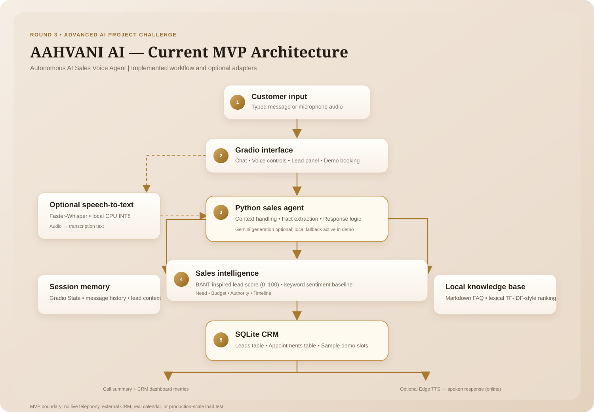

<div align="center">
  
  <h1>AAHVANI AI</h1>
  <p><strong>Autonomous AI Sales Voice Agent</strong></p>
  <p>Intelligence that speaks. Conversations that convert.</p>
</div>

AAHVANI AI is an evaluation-ready MVP that demonstrates how an AI sales assistant can handle an initial customer conversation, retrieve approved product information, capture buying signals, qualify a prospect, save a lead, book a sample demo slot and prepare a call summary.

> **Round 3 project:** Advanced AI Project Challenge & Technical Discussion — FORTIVEX AI PRIVATE LIMITED.

## Quick links for evaluators

| Material | File |
|---|---|
| One-page project report | [`project_report.md`](project_report.md) |
| Visual system architecture diagram | [`architecture/system_architecture.svg`](architecture/system_architecture.svg) |
| Architecture, deployment, security and scale plan | [`architecture/system_architecture.md`](architecture/system_architecture.md) |
| End-to-end practical demo script | [`DEMO_WALKTHROUGH.md`](DEMO_WALKTHROUGH.md) |
| Automated tests | [`tests/test_core.py`](tests/test_core.py) |

## System architecture



The diagram describes the **implemented MVP**, including its optional voice adapters. The 100,000-user design is a proposed production architecture documented separately; it has not been deployed or load-tested.

## Business problem and proposed solution

Small and medium businesses receive customer inquiries through websites, social media and other channels. Sales teams spend time answering repeated questions, gathering customer details, identifying serious prospects and arranging introductory demos.

AAHVANI AI demonstrates an automated first-line sales workflow. It aims to reduce repetitive initial work, capture lead information consistently and help salespeople focus on qualified prospects. It is designed for use cases such as agencies, service providers, education consultancies and real-estate teams.

The product used for the demonstration, **Northstar CRM**, is fictional sample data. It is not a real customer or external CRM integration.

## What the current MVP implements

| Capability | Current implementation | Status |
|---|---|---|
| Customer interaction | Gradio chat interface | Implemented |
| Contextual memory | Conversation and lead data in Gradio session state | Implemented |
| Product knowledge | Local Markdown FAQ with custom TF-IDF-style lexical ranking | Implemented |
| Response generation | Deterministic local response path; optional Gemini generation when configured | Implemented / optional |
| Lead qualification | BANT-inspired, transparent 0–100 heuristic | Implemented |
| Sentiment | Positive/negative keyword-count baseline | Implemented |
| Lead and appointment storage | SQLite `leads` and `appointments` tables | Implemented |
| Demo booking | User-confirmed sample slots persisted in SQLite | Implemented |
| Call summary | Structured summary generated from session information | Implemented |
| Speech-to-text | Optional Faster-Whisper, local CPU INT8 inference | Optional |
| Text-to-speech | Optional Edge TTS; requires internet | Optional |
| Full-duplex phone calls | Telephony, streaming, interruptions and call transfer | Future work |
| Multilingual experience | Whisper is multilingual-capable, but end-to-end multilingual UX and output voices are not validated in this MVP | Partial / future work |
| External calendar / CRM | No live third-party integration | Future work |

**Accuracy about the current demo:** Gemini is not configured in the default local setup, so the demonstration uses the deterministic local fallback. Faster-Whisper runs locally when the optional voice dependencies are installed. Edge TTS is an online service. The project does not provide a live phone number, real calendar availability or production telephony.

## End-to-end demonstration

Use synthetic details only. The full step-by-step script is in [`DEMO_WALKTHROUGH.md`](DEMO_WALKTHROUGH.md).

1. Start with a customer greeting and show that the agent responds.
2. Ask: `What features does Northstar CRM provide for a small marketing agency?` to demonstrate FAQ retrieval.
3. Submit this sample prospect message:

   `I'm Rahul, founder at BrightWave Agency. We need a CRM to manage leads and follow-ups. Our budget is ₹50,000, I make the final decision, and we want to implement it this month. My email is rahul@example.com.`

4. Show the extracted lead fields, score and qualification status.
5. Save the lead, select a sample slot and confirm the demo booking.
6. Generate the call summary and refresh the CRM table and KPI cards.

For the sample signals above, the BANT-inspired score is 100/100: Need 30 + Budget 25 + Decision authority 25 + Timeline 20. The score is a transparent heuristic, not a trained prediction model.

## Technology stack

- **Python:** agent logic, extraction, scoring and workflow.
- **Gradio:** interactive interface and session state.
- **SQLite:** local lead and appointment persistence.
- **Custom lexical retrieval:** local FAQ search; no vector database is used.
- **Gemini API:** optional response generation; requires an API key.
- **Faster-Whisper:** optional local speech recognition.
- **Edge TTS:** optional online speech synthesis.
- **unittest:** automated checks for core agent and CRM behaviour.

## Run locally on Windows

Python 3.11+ is recommended. The project has also been run locally with Python 3.13.

```powershell
git clone https://github.com/Yogeshyadav870/AAHVANI-AI.git
cd AAHVANI-AI

python -m venv .venv
.venv\Scripts\activate

python -m pip install --upgrade pip
python -m pip install -r requirements.txt
python -m unittest discover -s tests -v
python app.py
```

Open the local Gradio URL printed in the terminal (normally `http://127.0.0.1:7860`).

### Optional: Gemini-powered response generation

Install the optional package:

```bash
pip install -r requirements-gemini.txt
```

Set `GEMINI_API_KEY` in a local `.env` file. Never commit API keys or the `.env` file. Without a valid key, the deterministic local response path remains available.

### Optional: voice input and output

```bash
pip install -r requirements-voice.txt
```

Faster-Whisper downloads its selected model the first time it is loaded. The model is cached in the running process. Edge TTS requires internet access. After recording, review the transcription and click **Send voice message & hear reply**.

## Testing

Run:

```bash
python -m unittest discover -s tests -v
```

The repository includes tests for lead scoring, fact extraction, conversation memory, FAQ retrieval, lead-to-booking workflow and SQLite CRM persistence/dashboard counts. These tests validate core logic; they are not a load or production-readiness test.

## Commercial feasibility

Potential customers include small and medium businesses that handle frequent inbound inquiries. A plausible commercial model is a monthly SaaS subscription with usage-based charges for voice minutes or conversation volume. Pricing would need to be validated through customer pilots.

Key success measures include qualified-lead rate, appointment conversion, response latency, cost per qualified lead, human handoff rate and customer satisfaction. Main variable costs are LLM usage (if enabled), speech-to-text, text-to-speech, telephony minutes, compute, storage and bandwidth. See the [architecture and cost model](architecture/system_architecture.md).

## Scalability, security and deployment

The current prototype runs as a local Gradio/Python application with SQLite and in-process session state. It is **not** production-scaled.

The documented production path for up to 100,000 registered users separates stateless application services from voice workers, uses PostgreSQL for durable transactions, Redis for session state, a vector database for semantic retrieval, queues for asynchronous tasks and horizontally scaled containers behind an API gateway. Sizing must be based on peak concurrent calls and request/audio throughput, not registered-user count alone.

Production controls would include TLS, encryption at rest, tenant isolation, authentication, role-based access, secrets management, call-recording consent, retention/deletion policies, audit logs, monitoring, backups and incident response. See [`architecture/system_architecture.md`](architecture/system_architecture.md) for the deployment, security and cost discussion.

## Known limitations and next steps

- No live telephony or full-duplex voice conversation.
- No external CRM or real calendar integration.
- Retrieval is lexical and based on a small local FAQ, not vector embeddings.
- Gemini is optional and not active in the default demo.
- Lead scoring and sentiment are rule/keyword baselines.
- Full multilingual interaction has not been validated.
- No authentication, multi-tenant isolation, production observability or 100,000-user load test in the MVP.

Next steps: integrate telephony and real calendar/CRM APIs, evaluate multilingual conversations, improve extraction and semantic retrieval, add production security controls, and conduct concurrency, latency and cost tests.

## Repository structure

```text
AAHVANI-AI/
├── app.py
├── agent.py
├── crm.py
├── knowledge_base.py
├── data/product_faq.md
├── assets/aahvani_logo.svg
├── architecture/
│   ├── system_architecture.md
│   ├── system_architecture.svg
│   └── round4_talking_points.md
├── tests/test_core.py
├── project_report.md
├── DEMO_WALKTHROUGH.md
├── requirements.txt
├── requirements-gemini.txt
├── requirements-voice.txt
└── .env.example
```

## Security and demo data

Use synthetic customer details only. Do not commit `.env`, API keys, database files, real customer records or call recordings. The local database is git-ignored. A production deployment requires privacy, consent, access-control, retention and security reviews.
