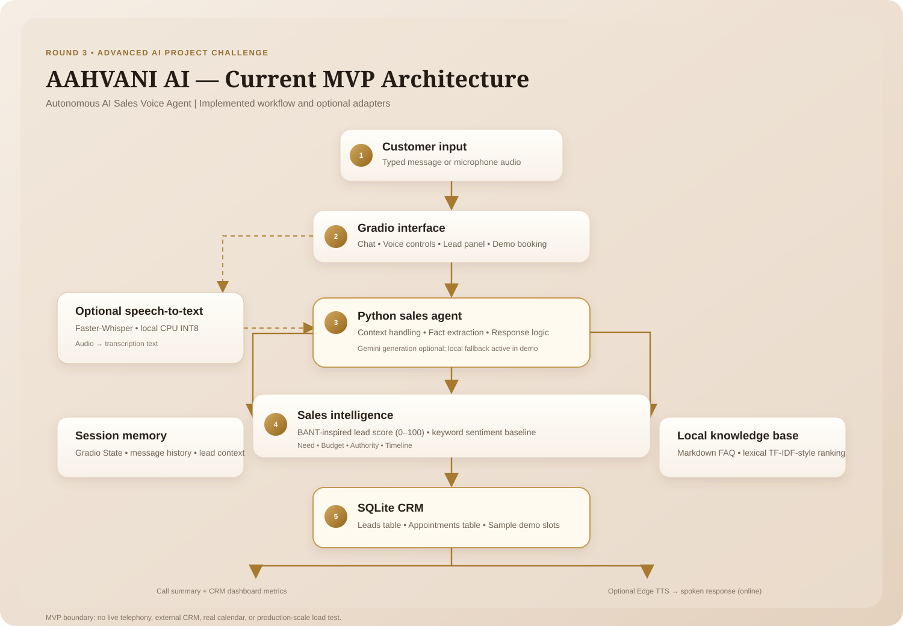
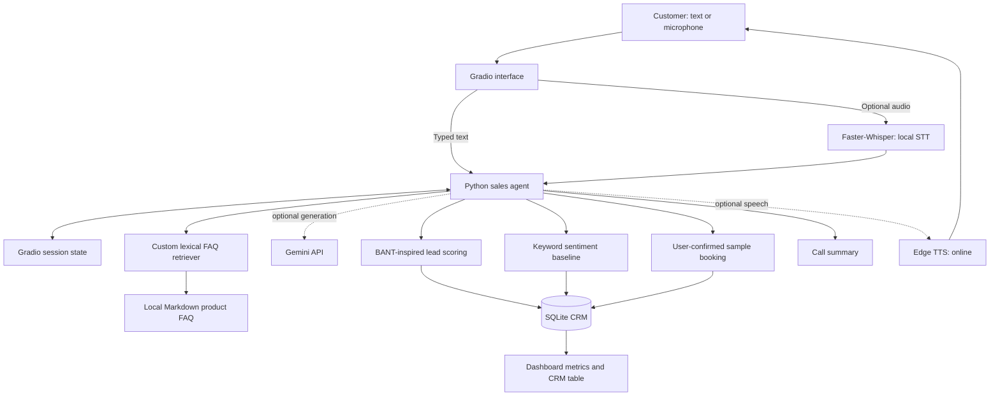

# AAHVANI AI — System Architecture



## 1. Current MVP architecture



## 2. Implemented request flow

1. The Gradio UI accepts typed text or optional microphone audio.
2. Faster-Whisper transcribes audio locally when the optional voice dependencies are installed. The selected model is cached in the running process after its first load.
3. The agent appends the message to the session history and extracts available facts such as name, email, phone, company, budget, authority and timeline using regular expressions and keyword rules.
4. The local Markdown FAQ is divided into sections. A custom term-frequency/inverse-document-frequency-style lexical scoring function ranks relevant sections and returns the top matches.
5. If Gemini is configured, the retrieved context can be supplied to the response-generation prompt. The default demo has no Gemini key configured and therefore uses deterministic local response logic.
6. The agent calculates a BANT-inspired score and a simple keyword-based sentiment signal.
7. The lead is saved to SQLite. A user can select a sample demo slot; the application validates that a contact method exists and persists the appointment linked to that lead.
8. The summary function creates a structured summary from the current session. SQL queries update the total-lead, qualified-lead and booked-demo counters.
9. For a voice turn, Edge TTS (online) converts the generated reply into an MP3 file.

## 3. Important implementation boundaries

- **Context:** Session messages and extracted lead fields persist during the active Gradio session. The default deterministic fallback is not a full LLM conversational planner.
- **Retrieval:** This is local lexical FAQ retrieval, not embedding-based semantic search or a vector database. The optional Gemini path can use retrieved text as generation context.
- **Lead scoring:** The score is a transparent heuristic, not a trained conversion prediction model.
- **Sentiment:** The current classifier is keyword-based, not a trained sentiment model.
- **Voice:** The prototype supports a one-turn record → transcribe → respond → speak workflow. It is not a live phone connection or full-duplex voice agent.
- **Multilingual:** Whisper supports multilingual speech recognition, but the complete multilingual experience, including language-specific response generation and TTS voice selection, has not been validated in this MVP.
- **Integrations:** The demo uses fictional Northstar CRM content and sample slots. It is not connected to an external CRM or real calendar.

## 4. Production design for up to 100,000 registered users

Registered users are not the same as concurrent active conversations. Capacity planning must estimate peak simultaneous voice sessions, average call length, audio throughput, request rate, model latency and service-level targets.

| Layer | Proposed production component | Purpose |
|---|---|---|
| Edge / ingress | CDN, WAF, API gateway, rate limits | Traffic protection and routing |
| Application | Stateless FastAPI services in containers | Horizontally scalable business APIs |
| Voice | Telephony/WebRTC gateway and separate STT/TTS workers | Isolate audio workloads from API requests |
| Agent orchestration | Tool registry, timeouts, retries and human handoff | Reliable workflow execution |
| Session state | Redis | Fast ephemeral conversation state |
| Transactional data | PostgreSQL | Durable leads, bookings and account data |
| Knowledge retrieval | Embedding pipeline and managed vector database | Semantic search with metadata filters |
| Async processing | Message queue and worker pool | Summaries, notifications and CRM sync |
| Observability | Central logs, metrics, traces and alerts | Latency, quality, cost and failure monitoring |
| Delivery | CI pipeline, container registry and managed container platform | Repeatable deployment and rollback |

### Deployment approach

**Current MVP:** Run locally with a Python virtual environment, install `requirements.txt`, run the unit tests, then start `python app.py`. Voice and Gemini packages are installed separately from their optional requirements files. The application binds to localhost by default.

**Production path:** Package the API and worker services into containers; deploy behind an authenticated API gateway; provision managed PostgreSQL, Redis, object storage and a queue; store credentials in a secrets manager; use CI/CD with staged rollout and rollback; configure autoscaling, health checks, backups, dashboards and alerts. Voice services should be scaled using concurrent audio sessions and processing latency, not the total user count.

## 5. Security and privacy

The MVP is a local evaluation prototype and does not implement production authentication, multi-tenant isolation or enterprise security controls. Use synthetic demo data and never commit secrets, real customer records or recordings.

Before production:
- Use TLS in transit and encryption at rest.
- Enforce authentication, role-based access and tenant-level data isolation.
- Store API keys in a secrets manager; never in source control.
- Obtain explicit consent before recording or retaining calls.
- Define data minimisation, retention, export and deletion policies.
- Keep personal data out of application logs; maintain audit trails for sensitive actions.
- Validate tool inputs server-side and require explicit user confirmation before booking.
- Add backups, restore drills, dependency scanning and incident response procedures.

## 6. Commercial feasibility and operating-cost model

**Target customers:** Agencies, real-estate teams, education consultancies and other small or medium businesses with recurring inbound inquiries.

**Potential revenue model:** Monthly SaaS subscription plus usage-based charges for voice minutes or conversation volume. A pilot should validate willingness to pay, qualification quality and time saved before setting prices.

**Variable cost drivers:** LLM tokens when Gemini or another hosted model is enabled; STT and TTS minutes; telephony minutes; compute; database and object storage; network egress; monitoring; customer support.

A simple unit-economics view is:

```text
Contribution per conversation
= revenue attributed to the conversation
  - (LLM + STT + TTS + telephony + compute + storage + bandwidth)

Monthly operating result
= subscription revenue + usage revenue
  - fixed infrastructure, support and operating costs
  - variable conversation costs
```

Track cost per completed conversation and cost per qualified lead alongside demo conversion, response latency and human handoff rate. Use model routing, quotas, caching and asynchronous processing to control costs. Exact pricing and infrastructure sizing require pilot traffic and measured usage; this repository does not claim benchmarked production costs.

## 7. Reliability and next steps

Use idempotency keys for booking APIs, bounded retries, clear failure messages and human handoff. Treat retrieved documents as untrusted content and restrict retrieval to approved product data. Next steps are real telephony and calendar/CRM integrations, validated multilingual flows, improved extraction and semantic retrieval, production security, load testing and measured unit economics.
