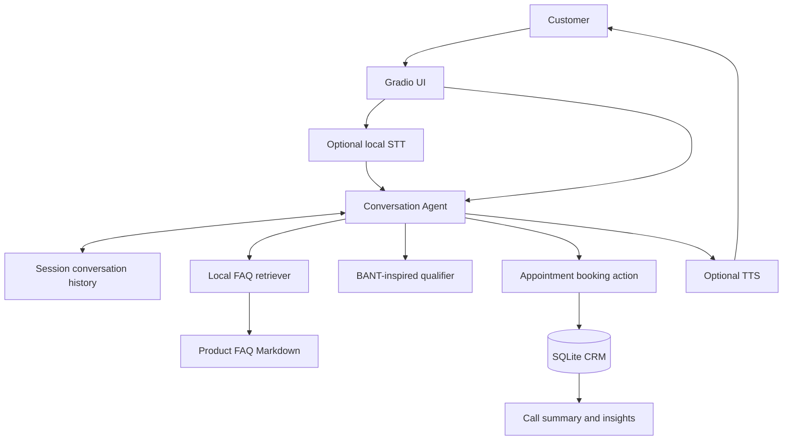

# System Architecture

## Current MVP

## Request flow

1. The Gradio interface receives a typed message or optional audio input.
2. When speech recognition is enabled, Faster-Whisper transcribes the audio into text.
3. The agent appends the customer message to session history and extracts available lead details.
4. The local retriever ranks approved FAQ sections using a lightweight term-frequency/inverse-document-frequency-style lexical score.
5. If Gemini is configured, the response generator can use the retrieved context. Otherwise, a deterministic local response path keeps the core demonstration available.
6. The agent updates the BANT-inspired lead score and keyword-based sentiment signal.
7. The booking action writes a lead and appointment to SQLite after a contact detail is supplied.
8. A call summary is generated from the session.
9. Optional Edge TTS converts the latest assistant response to spoken audio.

## Production architecture for 100,000 registered users

Registered users and concurrent voice sessions are different capacity dimensions. A production design must estimate peak simultaneous calls, average call length, audio bitrate, model latency and peak requests per second before sizing infrastructure.

- **Ingress:** CDN/WAF, API gateway, authentication and request throttling.
- **Application:** stateless FastAPI services deployed in containers and scaled horizontally.
- **Voice:** streaming telephony/WebRTC gateway, streaming STT, interruption-aware orchestration and streaming TTS.
- **Agent orchestration:** tool registry with strict schemas, timeouts, retries, idempotency keys and human-handoff policies.
- **Session state:** Redis for ephemeral conversation state; durable conversation metadata in PostgreSQL.
- **RAG:** document ingestion pipeline, embeddings, managed vector database, metadata filters, versioning and citations.
- **Transactional data:** PostgreSQL with indexes, backups, connection pooling and read replicas when justified.
- **Async work:** queue plus workers for summaries, CRM synchronization, analytics and notifications.
- **Observability:** centralized logs, metrics, traces, token/audio usage, latency, quality and failure-rate monitoring.
- **Security:** TLS, encryption at rest, tenant isolation, secret manager, RBAC, retention and deletion controls, consent management and audit logs.

## Reliability and safety controls

- Never book an appointment without explicit customer confirmation.
- Validate tool arguments on the server; do not trust model-generated values.
- Use idempotency keys to prevent duplicate bookings.
- Provide clear fallback and human handoff paths.
- Restrict RAG to approved company content and treat retrieved documents as untrusted data.
- Do not store raw recordings by default; define consent and retention before enabling recording.
- Keep customer data out of application logs and public repositories.

## Cost model

Operational costs depend on concurrent call minutes, speech-to-text and text-to-speech usage, LLM tokens, retrieval volume, storage, bandwidth and support. Measure cost per completed conversation and cost per qualified lead. Apply quotas, caching, model routing and usage-based plans.
