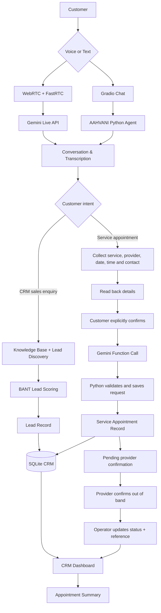

# AAHVANI AI — Sales & Service Appointment Workflow

**Appointment voice flow:** Customer speaks → Gemini Live understands the request → asks for missing details → reads back the appointment → waits for explicit confirmation → calls the Python booking function → saves the request and customer data in SQLite → updates the CRM table and call summary.

**Current implementation boundary:** Gemini can create a structured appointment request for Jalandhar or another city selected by the customer. The request starts as **Pending provider confirmation**. This release does not yet include a live provider directory or external provider/calendar APIs, so it cannot verify availability or claim a real-world appointment is confirmed. An operator may update the status after receiving confirmation from the provider.
