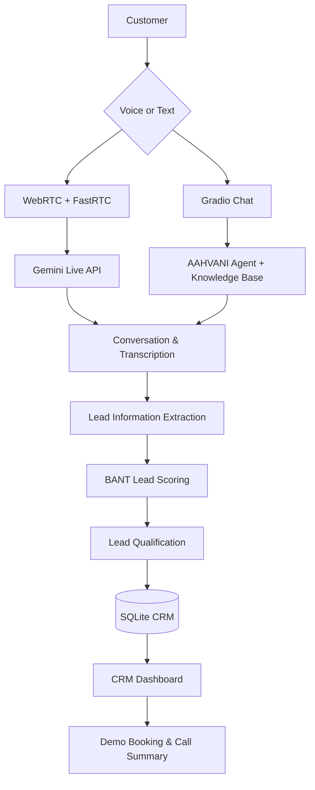

# AAHVANI AI — End-to-End Workflow

**Core flow:** Customer Input → AI Processing → Lead Extraction → BANT Scoring → Qualification → CRM → Demo Booking.

**Implementation note:** Voice and text are separate input paths that converge on lead extraction and CRM workflows. The current demo uses local SQLite storage and sample demo slots; it does not connect to an external CRM or live calendar.
